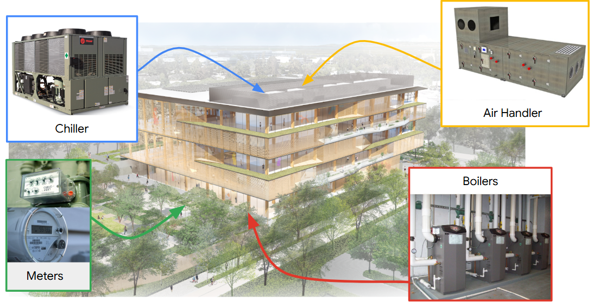
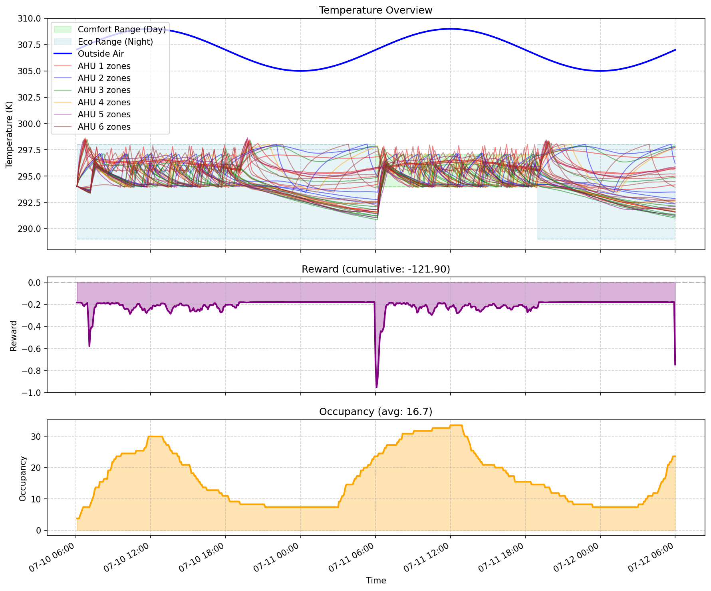

# Physics-Aware Hierarchical HVAC Control for Zero-Shot Building Transfer
### NeurIPS 2026 Smart Buildings Competition Track

**Author:** Tushar Bhardwaj ([ORCID: 0009-0007-6664-3235](https://orcid.org/0009-0007-6664-3235))  
**Kaggle Verified Score:** **0.01507** (*-72.2% regret vs. best official baseline pid_water 0.05414*)  
**Paper PDF:** [neurips_2026.pdf](paper/neurips_2026.pdf) | **LaTeX Source:** [neurips_2026.tex](paper/neurips_2026.tex) | **Submissions Archive:** [kaggle/](kaggle/)

---

### Empirical Progression on Official Kaggle Benchmark (30 Hidden Scenarios)

| Submission | Notebook / Code | Leaderboard Score (MAE) | Advantage vs. Baseline | Key Architectural Lever |
| :---: | :--- | :---: | :---: | :--- |
| **Baseline** | Official pid_water | 0.05414 | Baseline | Spatial mean hot water reset + coupled fan |
| **Iteration 1** | [iteration_1_standby_decoupling_lb0.04165.ipynb](kaggle/notebooks/iteration_1_standby_decoupling_lb0.04165.ipynb) | **0.04165** | **-23.1%** | Per-zone PI band-centre tracking & heating static pressure decoupling |
| **Iteration 2** | [iteration_2_modulated_dp_coasting_lb0.04188.ipynb](kaggle/notebooks/iteration_2_modulated_dp_coasting_lb0.04188.ipynb) | **0.04188** | **-22.6%** | Soft pump differential pressure modulation and end-of-day thermal coasting |
| **Iteration 3** | [iteration_3_preconditioning_hysteresis_lb0.04091.ipynb](kaggle/notebooks/iteration_3_preconditioning_hysteresis_lb0.04091.ipynb) | **0.04091** | **-24.4%** | Dynamic preconditioning window and heating hysteresis to eliminate chatter |
| **Iteration 4** | [iteration_4_multiregime_cooling_hold_lb0.01540.ipynb](kaggle/notebooks/iteration_4_multiregime_cooling_hold_lb0.01540.ipynb) | **0.01540** | **-71.6%** | 24-hour nocturnal cooling-run holding (288 steps) in hot climates |
| **Run 5 (Master)** | [iteration_5_climate_adaptive_master_lb0.01507.ipynb](kaggle/notebooks/iteration_5_climate_adaptive_master_lb0.01507.ipynb) | **0.01507** | **-72.2%** | Continuous cyclic tracking, demand Floating SAT, and subzero hydronic reset floor |

---

# Smart Buildings Foundation Model Competition — Starter Kit

Develop a single control policy that operates the HVAC systems of commercial
buildings across a range of layouts and weather conditions, deciding when to
run each air handler and the hot-water pump, setting their temperature and
pressure setpoints, and dividing the resulting air between zones to jointly
minimize energy cost and carbon emissions while maintaining occupant comfort.



The evaluation spans **6 buildings × 5 weather regimes = 30 scenarios**. A
submission is one policy that must generalize across all of them.

The competition runs on Kaggle. For the rules, the leaderboard, the submission
template and how to enter, see the competition page:
**<https://www.kaggle.com/competitions/neurips-2026-smart-buildings/>**

## Task

**Action (hybrid, per step):** for each air handler and the hot-water pump, a
discrete on/off run command plus continuous supply-air temperature, static
pressure and recirculation setpoints (and supply-water temperature and
differential pressure for the pump); and for each VAV box, a damper position and
a reheat valve position. Actions are normalized to `[-1, 1]` (continuous) and
`{0, 1}` (discrete). For a building with `K` air handlers and `V` zones, the
discrete action has shape `K+1` and the continuous action has shape `3K+2+2V`.

The air handler picks one supply-air temperature for every zone it serves, so
the per-zone dampers and reheat valves are the only place a per-zone decision
can be made. Ventilation floors are enforced by the simulator: a running air
handler holds a minimum static pressure and cannot recirculate more than 70%,
and every damper is floored at 10% open, so "close everything" is not available
as an energy strategy.

**Observation (per step, length scales with the building):**
- Per zone: air temperature, current heating/cooling setpoints, damper position, reheat valve position, airflow setpoint
- Per air handler: supply-air temperature, static pressure, airflow (sensed + setpoints), recirculation, cooling-request count, fan run status
- Hot-water system: supply water temperature (sensed + setpoint)
- Building-level occupancy count and comfort-schedule flags (in comfort mode now / soon)
- Outside air temperature
- Time of day and day of week (cyclically encoded)

**Reward (per step):** a weighted trade-off of occupant productivity/comfort
minus energy cost minus carbon emissions (weights 0.6 / 0.2 / 0.2).

Because the number of air handlers and zones differs per building, both the
observation and action vectors change shape per building — there is no fixed
input/output layout to memorize. Your policy also receives a **building
metadata** dict at construction time (action indices, observation field names,
zone-to-AHU assignment, floor plan, schedule, normalization constants) so it
can adapt to each building's structure.


Each building is partitioned into zones served by a handful of air handlers, and
the partition differs from building to building — the policy must infer the
right control strategy from structure and live observations rather than recall
fixed setpoints. A single day's rollout tracks zone temperatures against the
comfort band, the per-step reward, and occupancy:



## Layout

```
smart_buildings/
  smart_control/            # the building simulator (environment, simulator, reward, models, proto, utils)
  baselines/                # reference policies you are scored against
  buildings/                # the 6 building definitions the set is built from
  weather/                  # weather presets (6 recorded stations; the set uses 5)
  training_scenarios/       # 30 generated scenarios (building × weather), each with config.gin
  run_floor_generator.py    # sample new building configs
  run_scenario_generator.py # building × weather -> runnable scenarios
  run_environment.py        # load one scenario, inspect its spaces, smoke-test it
  evaluate.py               # test YOUR policy on scenarios (env loading, rollout, POLICY_MAP)
images/                     # figures used in this README
```

## Install

```bash
pip install -e .
```

## Quickstart

```bash
# 1. Look at one scenario: its action/observation spaces and a quick rollout
python -m smart_buildings.run_environment --building building_train_1 --weather fairbanks_1

# 2. Evaluate the starter policy on all 30 scenarios
python -m smart_buildings.evaluate
```

That runs `transfer`, the starter policy in
`smart_buildings/baselines/transfer_policy.py`. As shipped it returns the zero
action every step, so the evaluator works out of the box and you have a running
shape to edit. **That file is where you write your policy.**

The 30 scenarios are 6 buildings against 30 weather strips, paired so that each
building sees one strip per station and no strip is used twice. Strips are named
`<station>_<n>` for the five stations in the set — `fairbanks`, `denver`,
`atlanta`, `phoenix` and `singapore` — so `fairbanks_1`, `phoenix_6`, and so on.
A sixth station, `minneapolis`, still ships as generator input, but no shipped
scenario uses it. `training_set.yaml` is what defines the set.

Each strip replays a different 30-day window of recorded 2023 hourly station
data, which is 8,640 steps at the five-minute timestep. Every step is scored;
there is no warm-up period. There is no synthetic weather option. Buildings
differ in envelope construction as well as in geometry, so two buildings under
the same station still behave differently.

The pairing is listed in `smart_buildings/training_set.yaml`. Not every
building/strip combination exists, so check what a building has with
`ls smart_buildings/training_scenarios/building_train_1`.

## Writing your policy

**Edit `smart_buildings/baselines/transfer_policy.py`.** It carries the full
interface contract in its module docstring — action layout, observation layout,
what each setpoint physically does, and the traps. Read that first;
it is the reference, not this section.

A policy is a plain Python class with two methods. No base class, nothing to
subclass:

```python
class TransferPolicy:
    def __init__(self, building_meta_data, action_spec):
        # building_meta_data: dict with action indices, observation field names,
        #   zone-to-AHU assignment, floor plan, schedule, normalization stats, ...
        # action_spec: the hybrid action spec for this building
        ...

    def get_action(self, obs) -> dict:
        # return {"continuous_action": np.float32[3K+2+2V],
        #         "discrete_action":   np.int32[K+1]}
        ...
```

Keep the class name and you need change nothing else — it is already registered
in `POLICY_MAP`. Rename it, or add a second policy, and register it there under
whatever key you want to pass to `--policies`.

Two things worth repeating from the docstring. **The continuous action is
interleaved**, `[temp_0, pressure_0, recirc_0, temp_1, ...]` with the two
water-system entries appended and the zone entries after those. Read
`building_meta_data["temp_indices"]`, `["pressure_indices"]`,
`["recirculation_indices"]`, `["water_indices"]` and `["zone_action_indices"]`
rather than assuming offsets. A policy that hardcodes the layout looks like it
works and quietly drives the wrong actuator.

And **the zero action is not the off action.** Zero is the middle of each
normalised range, so a slot you never write is a half-open damper, not a shut
one. Write every slot you care about, including the ones you want at rest.

### Evaluate your policy

```bash
# One scenario, full 30-day episode
python -m smart_buildings.evaluate --policies transfer \
    --buildings building_train_1 --weathers fairbanks_1

# All 30 scenarios
python -m smart_buildings.evaluate --policies transfer

# Smoke test: one day, fast, NOT comparable to the baselines
python -m smart_buildings.evaluate --policies transfer \
    --buildings building_train_1 --weathers fairbanks_1 --steps 288
```

The `--steps` default is 8640, the full 30-day episode, which is the length
`baseline_returns.json` was run at. Pass a shorter horizon only for a smoke
test: short horizons skip eco-setback periods and flatter schedule-aware
policies. Never compare returns taken at different step counts — a shorter
episode is less negative, so a weaker policy can look better.

This writes `smart_buildings/results/<building>/<weather>/<policy>/summary.json`
(plus charts and time series) for every scenario.

## Generating more training data

Building generation is procedural, so you can sample as many additional
buildings and scenarios as you like during development (the held-out evaluation
buildings come from the same generator and ranges).

```bash
# Sample 10 new buildings (seeds 500-509) as YAML + PDF previews
python -m smart_buildings.run_floor_generator --start-seed 500 --count 10

# Turn buildings × weather strips into runnable scenarios
python -m smart_buildings.run_scenario_generator \
    --buildings building_0500 building_0501 --weathers fairbanks_1 phoenix_6

# Inspect / plot a generated scenario
python -m smart_buildings.run_environment --building building_0500 --weather fairbanks_1
python -m smart_buildings.run_scenario_generator --plot building_0500 fairbanks_1
```

Naming `--buildings` or `--weathers` takes the **cross product** of the two
lists. Running `run_scenario_generator` with no arguments instead rebuilds the
30 shipped pairs from `training_set.yaml`.

Two things to know about what you generate:

- **Construction.** Each generated building gets its own `materials:` block,
  drawn the same way the shipped six were: six envelope properties sampled
  independently and stratified across the batch. See
  `smart_control/utils/materials.py` for the ranges and the reasoning. Pass
  `--no-materials` to fall back to one default construction.
- **Air handler count.** `num_ahus` in the YAML is a floor, not the answer. The
  scenario generator raises it to `ceil(zones / 10)`, so the footprint decides
  the count. The default footprint ranges are larger than the shipped six, so
  a generated building can carry more air handlers than any shipped one — and
  cost proportionally more to simulate. Shrink `width` and `height` in the YAML
  if you want buildings sized like the shipped set.

## Reference baselines

`POLICY_MAP` in `evaluate.py` ships five policies besides `transfer`, so you can
see what you are competing against:

| key | what it does |
| --- | --- |
| `bang_bang` | per-air-handler on/off around the comfort band |
| `fixed_setpoint` | one comfort band around the clock, no eco setback |
| `pid` | proportional control, fan pressure scaled by control effort |
| `pid_water` | `pid`, plus modulating reheat and a demand-driven hot water reset |
| `all_off` | never runs any equipment |

Run any of them with `--policies`, e.g. `--policies pid bang_bang`.

The first four are scored alongside your policy as a reference range. `all_off`
is provided so you can see what an unconditioned building costs; it is kept out
of that set because a policy that never runs the plant is not a controller
anyone would write, so it tells you nothing about where a real one stands. See
the comment on `BASELINES` in `score_leaderboard.py`.

There is no learned baseline. Bring your own.

## Scoring

Each scenario reports the policy's **total reward** — the per-step trade-off of
occupant comfort against energy cost and carbon emissions, summed over the
episode.

The leaderboard metric is the **mean absolute error against a target of zero**,
taken over the per-scenario mean per-step reward. **Lower is better.**

The per-step reward is never positive: comfort shortfall, energy cost and carbon
emission are all charges, and nothing is credited. So the absolute value is just
the size of your loss, and zero would mean perfect comfort delivered at no energy
and no carbon cost, which nothing can reach. Treat zero as the ideal and your
score as the distance from it.

The 30 per-scenario values are averaged with equal weight. There is no
per-building or per-weather score: grouping is deliberately avoided, since any
grouping imposes an arbitrary weighting and hides within-group variance.

The baseline returns ship in `baseline_returns.json` at the repo root — the
four baselines run on all 30 shipped training scenarios with 8640-step
(30-day) episodes. They do not enter the metric, which needs no baselines.
`score_leaderboard.py` prints them next to your score as a reference range to
develop against, so you only need to evaluate your own policy. 8640 is the
`--steps` default, so a plain `evaluate` run is already scoreable.
Returns from different episode lengths are not comparable, so scoring is
refused outright if your policy was run at any other step count. Pass
`--baselines self` to read the reference returns from your own results tree
instead, which requires running the four baselines alongside your policy.

The official ranking is computed server-side on Kaggle
(<https://www.kaggle.com/competitions/neurips-2026-smart-buildings/>) over
held-out evaluation buildings, drawn from the same generator and parameter ranges as the shipped
six. Their weather strips are built the same way, from recorded station data,
and none of them is a strip shipped here. So your policy has to transfer to
**buildings and weather it has not seen**, rather than memorize the shipped
set.

## Reference file guide

| File | What it does |
| --- | --- |
| `run_floor_generator.py` | Sample building configs (`building_XXXX.yaml` + PDF preview). |
| `run_scenario_generator.py` | Combine buildings × weather into `training_scenarios/` (`config.gin`); can plot a scenario's floor plan and zone map. |
| `run_environment.py` | Load one scenario, print its action/observation spec and metadata, run a short rollout. |
| `evaluate.py` | Evaluate **your** policy (any key in `POLICY_MAP`) on selected scenarios. |
| `score_leaderboard.py` | Turn a results tree into the single leaderboard number, and print the reference baselines beside it. Reads the shipped `baseline_returns.json` by default; `--baselines self` reads those reference returns from your own tree. |
| `baseline_returns.json` | Baseline `total_reward` per training scenario, at 8640-step episodes. Printed by `score_leaderboard.py` as a reference range; it does not enter the metric. |
| `check_scales.py` | Assert every scenario's reward denominators match the expected `c x K`. |

## License / attribution

Apache License 2.0 (see `LICENSE`). Builds on Google's open-source Smart
Buildings Simulator; see `NOTICE`.
